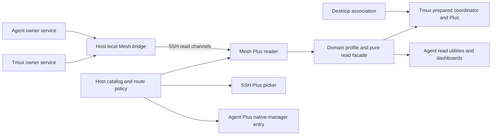

# Mesh Plus architecture and decisions

For current product responsibilities and capability support, start with the
[ecosystem role guide](ecosystem-role.md). The design below retains its wire
and ownership scope; source/artifact/host selection follows independent owner
records. Agent Plus now uses host routing for native manager entry and does not
consume the state-delivery branch.

## Contract first

A configured fleet and a domain contract are inputs. Mesh Plus invokes that
contract on selected owning hosts and composes their independent results. Local
access is the one-host case of the same mesh-aware contract. Native collection,
provider classification, desktop association and action authorization remain
outside Mesh Plus.

The base contract specifies the common `mesh` section, read selection and bridge
delivery. Domain profiles supply record schemas, source interpretation and pure
projection. A Tmux result and an Agent result share networking semantics without
becoming one universal session model.

The bridge exports an owning host's configured source, never its aggregated
fleet. Initial IPC/SSH readers initiate connections and publishers send updates
back on those channels. Opposite-direction readers are independent. There is no
distributed replication or reverse desktop callback. SSH needs no additional
network listener; a future WSS backend explicitly hosts a Mesh endpoint.

Mesh owns request/reply and subscription delivery. The
[transport design](transport-design.md) introduces a backend-independent session
protocol and supported embedded/local-service topologies. SSH is an initial
backend choice, not a requirement of the domain or base delivery contract.

## Local and fleet equivalence

The proposed domain response is `{protocol, schemaVersion, mesh, sessions}`.
`mesh.hosts[].owner.metadata` contains the original snapshot fields other than
`sessions`; owner service framing, when present, is retained separately.
Recombining those fields with that host's rows reconstructs its original domain
document. This avoids duplicating the entire snapshot and preserves coverage,
errors, source namespaces and all original evidence clocks.

This metadata layout is a design candidate exercised by fixtures, not a promise
that every existing public envelope is unchanged. The intentional changes are
replacing singular top-level host/source metadata with per-host metadata and
adding a common delivery contract. The expensive semantics stay unchanged:
session records, complete references, unknown states and domain classification.

Consumers select local, explicit hosts or fleet, then use one domain parser and
selector. A pure `effective_view(response, clock)` facade is part of each new
profile. It applies Mesh validity to the domain's existing uncertainty rules.
Raw retained rows are historical evidence until their required receipts are
current. A client must not bypass the facade by treating a retained `running`
value or attached-client count as current on its own.

## Decisions

| Decision | Reason |
| --- | --- |
| Keep session row schemas and exact identities | Host scope already exists in both Observers; transport cannot improve identity |
| Add one shared mesh section | Local and fleet parsing use one shape and one failure model |
| Keep domain metadata per owner | Coverage, namespaces and generations remain attributable and independently validatable |
| Separate delivery completeness from source coverage | Successful delivery preserves a producer's partial coverage |
| Start with cached snapshot and watch | Both owner services already share passive collection; a read must not trigger collection |
| Preserve existing explicit direct diagnosis | Its invocation, collection behavior and old envelope do not change implicitly |
| Use fixed source adapters in a host-local bridge | Freshness proof can wrap existing local cached reads without modifying providers |
| Keep domain versions independent of Mesh version | Agent observation work must not force a Tmux release or native-entry migration |
| Extract a reusable delivery/session engine first | IPC, SSH and a future WSS backend share request/subscription semantics |
| Support embedded and local per-user service topologies | Several consumers may share upstream channels without a central fleet broker |
| Retain Tmux's existing coordinator initially | Desktop, refresh tickets and installed acceptance have separate authority |
| Keep observation channels read-only | Recovery cannot dispatch New, Resume, Kill or viewer actions |

## Scope and failure isolation

A read binds an immutable catalog revision and ordered host selection. It contains
one outcome for every selected host, including failed and warming hosts. Catalog
or capacity failure is a request-level error; it cannot silently select a subset.
A later catalog revision replaces the reader scope and invalidates old routing
authority. Old replies are rejected by request, catalog and connection epoch.

Connection recovery is per host and source. Two sources on one host may have
different compatibility or health. A failed Agent source does not erase healthy
Tmux delivery. One slow reader cannot stall collection or another subscriber.
Domain coverage and memory retirement remain producer decisions.

## What is deferred

Agent's newly reviewed event product uses ordered replay and per-host cursors,
not state replacement. The [event delivery boundary](event-delivery.md) preserves
that distinction and defines its following contract gate. Current state delivery
does not wait for that unimplemented producer wire.

Direct collection through the new common contract needs a separate domain
validity profile. Existing direct commands remain available. Fleet writes,
durable replay, notification event guarantees, global pagination and automatic
cross-host identity merging are also deferred. Headless owner access is required;
desktop joins are optional downstream work.

A local per-user Mesh service is now a supported design target. Extract the
embedded engine first, then measure and accept the wrapper before several
independent clients adopt it. State sharing binds authenticated authority,
catalog/route, host/source/product/profile and upstream selector. Event replay
interests need independent barriers or channels. Desktop context and local
presentation filters do not enter the upstream key. Different users or source
authorities never share a channel merely because labels match.

## Alternatives considered

| Alternative | Assessment |
| --- | --- |
| Generic nested local results only | Simple transport, but gives existing row-oriented clients a substantially different interface |
| Flatten rows and omit owner outcomes | Loses complete-empty versus unavailable and source/namespace provenance |
| Merge domain sources into one synthetic local host | Corrupts identity, clocks and coverage |
| Make both Observers fleet daemons | Duplicates networking and couples native services to topology |
| One mandatory central broker immediately | Not required by subscriptions; local sharing has its own measured deployment choice |
| Raw SSH watch forwarding | Delivery and heartbeats cannot prove remote remaining leases |

The candidate combines flat records with attributable owner metadata and a
common validity section. Its deliberate versioned envelope migration is the
price of keeping local and fleet clients equivalent thereafter.
