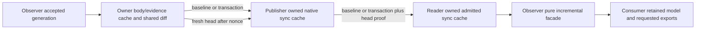

# Snapshot and delta synchronization: Mesh proposal

Status: G0 contract proposal, 2026-10-16 UTC. Execution has subsequently been
authorized, but RLCD must close the concrete joint G0 before runtime/schema
edits. This document allocates no protocol IDs, interface/package versions or
artifacts. It changes no installed selection or frozen contract.

## Inputs and scope

The shared brief is
`esp32-rlcd/projects/agent-dashboard/docs/delta-sync-plan.md`. Mesh source
inspected here is `7c30fc92caf03476e239c10a3bb8cad97f365d90`, runtime `1978805`,
published a23, paired Observer a7. Planning began from the clean
`mesh-active-feed-20261016` branch; the local `main` reference still names the
older `3b7582d` and has not been moved. Source identity takes precedence over
branch labels. A later implementation branch must start from the inspected head.

Current accepted [full/active interfaces](active-feed-api.md),
[SDK 1](sdk-api.md), [freeze](contract-freeze.md) and lock 5 remain authoritative.
This proposal covers generic sampled-state synchronization for both a requested
full inventory and the separate active scope. It does not turn state differences
into an occurrence-event journal or promise observation of every native change.
Tmux stays on its accepted route until its owner independently adopts a sync
profile. Native collection, UI retention policy, provider actions and deployment
are outside Mesh implementation ownership.

## Source findings: why a delta envelope alone is insufficient

| Current boundary | Work that must change on the opt-in route |
| --- | --- |
| Observer cached source | `snapshot()` receives/parses a complete Service 4 or active frame; a proof requests another full cached read |
| `CachedPublisher._wrap()` | Deep-copies native input, calls complete native admission/round-trip validation and hashes the whole frame, then validates the reply again |
| Reader / `view._validated_response()` | Reconstructs every host native frame and admits all records; encodes/hashes complete aggregate bytes |
| `AdmittedResponse` | Owns complete serialized response bytes; opening it decodes the full aggregate |
| Prepared guard / selection | Serializes every replacement and compiles/classifies every row per generation |
| Observer active facade | Owns a full selected snapshot per replacement and exports context/field masks on reads |

Those are correct accepted replacement semantics. Reusing those implementations
behind a delta-shaped wrapper would retain O(N) work at multiple boundaries.
Likewise, a single SHA-256 of a reconstructed full document is not an incremental
result commitment. New APIs and explicit profile/native contracts are required.

## Chosen architecture

Use an explicitly negotiated synchronization route with an admitted baseline,
atomic state transactions and a fresh compact head proof. Keep the existing
replacement routes and APIs intact. The sync cache is reusable state, not a cache
of successful validation for caller-owned dictionaries.



Each receiving boundary decodes and admits newly received bytes once. A local
owned token may cross another callback boundary only with exact cache/profile/
callback/epoch binding; it is never transmitted as proof of admission. A second
process must independently admit its baseline and changed facts.

The first implementation may scan/diff/hash an accepted owner generation once.
It must share that result across local subscribers and publishers. That O(N)
generation cost is measured, not described as sparse work. Subscriber reads,
proofs and repeated reads must not cause a new full acquisition, diff, body hash,
decode, round-trip validation or full export. Changes to N genuine observation
facets are K=N work even when every stable body remains equal.

## State decomposition and exact observation support

The new native DTO has separately committed keyed spaces:

| Space | Contents |
| --- | --- |
| Record slots | Full domain identity, record birth/version token, stable body ID, ordering token |
| Stable bodies | Immutable canonical body bytes, content-addressed and validated on insertion |
| Observation facets | Actual changing observation fields and binding references excluded from stable bodies by the reviewed domain contract |
| Binding sets | Exact `(identity, field, validated-content-token)` memberships for an observation cohort |
| Cohort heads / receipts | Exact original service/source/context/component/accepted/sample/expiry support; at most 32 current receipt entries per host |
| Scope / owner metadata | Coverage, uncertainty, nonmember facts, continuity, failures, attempts and every other material source field required by the chosen view |

Observer must freeze the exact stable-body/facet split. API 4 sample-clock
`observedAt`, timing observation/receipt fields and per-field support cannot just
be discarded because they change frequently. They either become explicit facet
changes or derive losslessly from an explicitly carried original observation
anchor. Native event/activity times stay native times. Encoding time and a new
head/proof timestamp never become observation time. Old Service 4/active-1 rows
and their wire meaning are not silently rewritten.

Adopt Observer's exact first factorization: content is the API 4 row with only
these paths moved into a lossless per-row observation object:

```text
runtime.health, runtime.observedAt
phase.health, phase.observedAt                     (when phase is not null)
activity.health, outcome.health
lastUpdated.health, lastUpdated.observedAt, lastUpdated.receipt
latestTurn.health, latestTurn.observedAt, latestTurn.receipt
```

All other paths and optional keys stay content, including outcome event time,
native activity/thread/turn times, reasons and last-known representations. No
batch wall time substitutes for individual values. The nine supported field
tokens are runtime, phase, kind, saved identity, activity, outcome, workspace,
lastUpdated and latestTurn. Phase tokens include blocked reasons; changing only
title does not invalidate runtime support. Observer owns the exact extraction
table and joined-row semantic vectors before dependent code.

Binding membership can encode admitted key references and a nine-bit field mask;
each receiver computes corresponding tokens from validated content. Repeating
64-character hashes per cell is unnecessary. Wire aliases are epoch/birth-bound
committed dictionary entries, never substitutes for the five-part identity.

### Cohort renewal

Mesh accepts Observer's proposed sealed binding-set mechanism, subject to exact
schema review. A cohort binds an immutable admitted set of identity/field/content
tokens to one actual observation support. Reuse the set root with a new support
only when the owner actually reobserved **every** member with those exact values.
This is an explicit native claim, validated by the domain profile and qualified
against engine provenance; a new receipt under the same component key is not
such a claim. Retained/missing/unobserved cells remain tied to their old support
and become context-only when it no longer exactly matches the current map.

Changed membership, content, chosen producing component or individual anchors
must patch the corresponding binding/facet state. These changes count toward K.
The shortcut is valid for identical actually reobserved sets, not arbitrary
row-wide renewal. Cohort membership and support heads are part of the result
commitment. No unbounded per-identity history of positive receipts is added.
Context-only original stamps are bounded state, never additional current leases.

An unchanged body can survive a changed cohort, a failed component, expiry or
record removal as owned informational content. It cannot carry a reusable
`current=True` flag. Queries evaluate original support and the reader clock each
time. Global evidence invalidation can be represented by a compact head change;
it must invalidate dependent facts even without body upserts.

## Identity, ordering and commitments

Use two commitment layers. The native scope binds native contract/schema,
native host/UID, full/active view, canonical selector when active, owner
incarnation, source clock contexts and projection continuity. It contains no
configured Mesh alias or Mesh imports. Mesh independently wraps that native
root/cursor with authenticated configured host, source alias and profile/contract
digests in O(1). Equal native bytes do not transfer source authority. Catalog revision,
ordered selected hosts, route/channel/request epoch and reader incarnation bind
the acquired handle. A hash never substitutes for those checks.

Define a `CommitTag` as scope/owner epoch, monotonically increasing generation
and result root. Source generation and channel/subscription sequence are distinct.
Every transaction names the exact base tag and resulting tag. Generations may
skip only when the source explicitly composes a complete contiguous change chain;
this remains sampled state, not event replay.

Use a deterministic incremental Merkle map, with domain-separated canonical
leaf/branch hashes, for record slots, facets, binding memberships and metadata.
Recommended construction is a compressed binary radix tree over SHA-256 of the
canonical keyed identity: at most 256 branch steps per update, deterministic
shape independent of insertion order, and at most `2*leaves-1` occupied nodes.
Hash collisions between different canonical keys are rejection, never aliases.
The [contract appendix](delta-sync-contract-appendix.md) specifies exact framing,
root composition, public staging and vectors for independent reproduction.
Do not use XOR accumulators, insertion-order roots or a full sorted
JSON rehash disguised as an incremental root.

`resultRoot` commits the scope, generation, all map roots/counts, exact original
receipt map and material domain metadata. Every changed body is hashed locally;
every changed map path and root is recomputed locally. The peer-provided result
root must equal that computed result. A body hash can reuse only already owned
and admitted bytes in this exact profile/epoch context.

Record removal followed by same-key reinsertion creates a new record birth
token, even if body bytes are identical. Use an epoch plus creation generation
token so forgotten identities need no permanent tombstone counter. Old handles
cannot acquire the new entry's authority. A body store may reuse identical bytes;
that does not reuse record-instance binding. Meaningful record ordering uses
a committed ordered index. Adopt Observer's full key
`(runtime.value != "running", five-part identity)`, with active's bounded
original source/scope order then identity within scope. Preserve other bounded
owner arrays in metadata. Do not use shifting integer row positions that turn
a sparse insertion into N slot changes.

## Baseline, transaction and atomic admission

The following are proposed message categories, not allocated identifiers:

```text
Baseline(scope, resultTag, slots, bodies, facets, bindingSets, heads, metadata)
Transaction(scope, transactionId, baseTag, resultTag,
            slotUpserts, slotRemoves, newBodies, facetChanges,
            bindingSetChanges, headChanges, scopeMetadataChanges)
HeadProof(scope, targetTag, nonce, sourceLiveness, sourceClock,
          originalReceipts, bridgeEncodedAt, requestBinding)
ResyncRequired(scope, reason, currentTag?)
```

There is at most one operation per key within each typed space in a transaction.
An upsert/removal includes its expected old entry token where applicable. Enforce
unique identities/keys, exact base and scope, reference existence, sizes/counts,
new body schemas/content hashes, original evidence monotonicity and all domain
cross-record invariants before publication. A changed result digest, invalid
cell/cohort, missing body, callback failure or cancellation publishes nothing.

The generic cache stages persistent structural changes and a separate domain
index patch. Observer receives read-only indexed access and only changed typed
cells/affected scopes. It returns serializable/frozen facts and an index patch,
not an arbitrary retained mutable object. Generic ownership validates/freezes
those results and commits material state/index together. Callback mutation or
descriptor/callback replacement retires the cache and all authority handles.

Cross-record checks need incremental indexes: identity uniqueness, body/slot
references, support memberships, per-scope member/body correspondence and
coverage/completeness conditions. An arbitrary `validate_full_view()` fallback
on each update is not an implementation of this interface. If a global invariant
cannot be maintained incrementally, name and measure that O(N) check before G0
closes. Profile callback lookup/visit counts are acceptance instrumentation.

## Fresh proof and authority publication

A remote baseline/delta is not current authority just because it has a matching
root. It first becomes an admitted candidate. A fresh unpredictable nonce is
admitted before the publisher asks the owner-hosted local service for its current
committed head. The local reply must be a fresh bounded operation, tied to the
actual current owner and cached generation; a retained watch object/live pipe
alone is insufficient. It must not serialize/decode/validate/hash all records.

The publisher independently matches that native head to its owned admitted
candidate/root and original receipt map, then returns compact proof of that
exact target. Reader checks nonce, request/channel epoch, target/scope/profile,
native owner/clock, complete original receipt map and original remaining leases.
Retain the two-second remote proof budget, whole-request RTT subtraction and
existing safety margin. Local paths retain exact clock/UID/socket checks and
original expiry. Heartbeats and body/set hashes grant no new validity.

Adopt the coordinator's separated proof/catch-up order; this supersedes the
earlier captured-head-with-chain sketch:

1. Reader supplies admitted target G and a new nonce. The original remote
   two-second proof deadline starts before queuing/sending the request.
2. Publisher calls live owner `head_after_nonce(challenge)` and captures H.
   This is an immutable acquisition point in O(P), P<=32, without full frame,
   active frame or expire/publish calls.
3. If H differs from G, reply only with bounded `moved` head/status. Revoke
   this host's current authority. No body, transaction or old-G proof is returned.
4. Separately obtain and independently admit `changes(G, target=H)` under the
   original 15-second acquisition deadline: at most four atomic transactions
   and 8 MiB changed bytes. Then issue a new nonce proof for the admitted H.
5. Matching proof validates native/source roots, scope, original receipts,
   clocks, nonce/request and RTT before publication. A later H+1 does not rewrite
   the captured matching read point, but a known moved head revokes authority.
   At most one moved-head catch-up/retry is allowed. A further move, evicted H,
   revoked source, quota or deadline exhaustion requires explicit baseline
   recovery/failure within the same absolute budget, never older substitution.

Cold/recovery baseline acquisition has the existing 15-second absolute budget,
with at most one moved-head proof retry inside it. A large baseline precedes compact
proof; it is not hidden in a two-second proof attempt. Same-result proofs still
do fresh liveness/original receipt checks, without body work. The <=8 MiB catch-up
region travels separately from the complete <=64 KiB proof head, each within
the unchanged data/control/message caps. Punctuation counts. Quota excess cannot initiate an
unbounded full read inside a proof or relax its deadline.

Committed health/counters/support, observation fields, collection/publication
anchors, failures and material diagnostics are rooted state. Head adds only
challenge/acquisition clock and monotonic remaining/health attenuation. It cannot
change accepted/sample/expiry or promote unavailable facts. Time expiry need not
rewrite rows; a failed observation/context change does create a material commit.
`export_committed()` reconstructs exact API 4 rows and committed snapshot/active
DTO anchors without granting currentness. Head envelope times are not a fabricated
fresh legacy Service 4 envelope.

Material/index publication is atomic. A proof/lease view binds exactly one
admitted commit. Public authoritative publication occurs only after the required
proof checks. Pending candidates cannot add/renew positive claims. Gap, source
loss, invalid admission, disconnect or clock/epoch mismatch revokes authority
immediately; informational bytes can remain owned. A domain-validated failure
may conservatively revoke dependencies before positive proof completes. The
last-confirmed view remains readable only until a known moved head, failure,
gap or clock/epoch loss revokes that host's authority. Pending candidates never
renew it. External uncertain
context is separate. No unproved candidate field/completeness leaks into it.

## Public API proposal

Use a separate explicit sync API/profile interface. SDK 1 `NativeState`,
`restore_native`, `Reader`, `AdmittedResponse` and prepared guards retain their
existing contracts. They are full-export/legacy paths, not the sync engine.

The [appendix public API](delta-sync-contract-appendix.md#public-immutable-staging-and-query-api)
is the single concrete signature proposal for joint closure: `CachedSyncSource`,
`SyncProfile`, `OwnedSyncCache`, `SyncReader`, `AggregateCommit` and `ViewRef`.
It supersedes this document's initial illustrative signatures. In particular,
confirmation accepts raw proof bytes for independent checks, not an arbitrary
caller-supplied checked-proof object. Reader yields aggregate handles with
independent per-host confirmation/status, not a fictitious fleet transaction.
No consumer code should guess these interfaces before closure.
Observer's facade resolves current fields and full/active membership semantics
through this supported view/index interface. It must not index private Mesh
state or reconstruct all rows on every accepted update. Full/current roster
enumeration and detached full exports inherently cost O(output); they must be
explicit and counted. Cached unchanged bodies are decoded on demand, not once
again for every consumer read. A header-only query or one-key query cannot hide
an N-row walk. Proof/clock checks remain mandatory even for an empty baseline.

`PublicStageContext` has immutable `before` and provisional `after` keyed views,
the typed changed operations, affected scope keys and a budget/visit meter.
Public lookup spaces expose slots, canonical bodies, observation facets,
validated field tokens, cohort memberships/heads, scope facts and reverse
dependency edges. No private-cache access is needed. Missing lookups are typed
absence, not invented default evidence. `members()`/`dependents()` expose bounded
lazy iterators whose visits are measured; callers cannot hide a full walk.

`DomainIndexPatch` contains only proposed keyed index writes/removals, changed
prepared rules, affected scopes and conservative invalidations. Mesh validates,
copies/freezes and allocation-charges it before publishing it with generic state.
The profile cannot mutate committed base/index, commit early, retain a mutable
borrow or return a pointer into arbitrary domain-owned state. `check_head` sees
only a public immutable commit view and bounded head, returning checked original
receipt/attenuation rules; generic code independently verifies root/nonce/RTT.
All callback/descriptor identities are pinned to the owned cache instance.

## Transport and compatibility choice

Recommend a distinct opt-in sync delivery contract and profile family, with
explicit baseline/transaction/head-proof semantics. Reuse IPC/SSH carrier
security/framing primitives and existing deadlines/credit accounting, not the
old replacement bridge's interpretation of a coalesced `view` as a resync.
Exact wire identifiers/versions remain unallocated. This is not promotion of
the reserved Delivery 1 digest-proof schema or native event/replay capabilities.

Current Delivery 1 has closed capability enums, and its bridge coalesces by
keeping only the latest replacement, then labels it resync. Dropping intermediate
deltas that way is invalid. A sync-aware bridge must either compose a fully
covered bounded chain into one exact base/result transaction or emit gap and
obtain a fresh baseline. A delta is never relabeled a baseline. Head proof and
cache transactions are new reviewed success shapes; current `ownerFrame` reply
admission cannot silently accept them.

Prefer separate source/profile routes for full-sync and active-sync, selected
by trusted installed factories. Profile/source binding alone never changes the
old route's meaning. Unsupported sync setup fails explicitly; no automatic switch
to legacy full acquisition or polling. A **sync-format baseline** on cold start,
gap, expired base or explicit reset is an allowed, visible recovery operation,
not an unadvertised legacy fallback. Full/Tmux old clients remain independently
supported. Existing source config/SSH argv must not become wire-supplied imports,
paths or arbitrary commands. WSS remains a separately qualified carrier if the
new route affects it; no runtime capability is inferred from generic syntax.

## Ordering, loss and recovery decisions

| Case | Required result |
| --- | --- |
| Exact base and valid result | Atomic commit after all domain/generic/proof checks |
| Exact duplicate last transaction | Idempotent acknowledgement only; no callback reapplication, new publication or lease renewal |
| Same transaction ID with different bytes, wrong base/result, reordered/stale update | Revoke affected sync authority and require a new baseline |
| Missing transaction / transport gap | Revoke; no best-effort partial apply; fresh baseline/proof |
| Source restart, selector/profile/context/clock change | New scope/epoch and baseline; old handles cannot regain authority |
| Unknown removed key / duplicate operation / body hash collision | Reject transaction; no partial state escapes |
| Remove a record | Remove from this reconstructed source view; no parked, deletion, acknowledgement or UI retirement assertion |
| Partial/expired membership or a missed negative | Preserve existing domain uncertainty/retained presentation context; no new timeout/query |
| Failure, cancellation or source disconnect during stage/proof | Abort candidate, revoke affected authority and retire owned resources |
| Journal/base unavailable, slow reader or capacity overflow | Explicit gap/resync-required or bounded failure, never hidden truncation |
| Ordinary unchanged proof/head | No full export/body decode/hash/validation; original evidence and liveness still checked |

No durable replay or exactly-once occurrence semantics are added. Exact duplicate
acceptance is bounded to the retained current/previous transaction identity;
older unknown duplicates require resync. Full baseline recovery on reconnect is
the first implementation choice; cross-connection resume is deferred.

## Proposed bounds for review

Preserve existing per-host native/full frame and aggregate limits. Sync-specific
limits below are proposed acceptance inputs, not allocated release promises.

| Resource | Proposed first limit/policy |
| --- | --- |
| Full/active records per host | Existing 4,096 native record ceiling; active recent-member ledger retains 4,096 / 1 MiB policy |
| Serialized admitted sync state per host | At most 8,404,992 bytes including body/facet/binding/metadata spaces; fail earlier if a domain byte cap applies |
| Wire message / control / aggregate | Existing 8,470,528 / 65,536 / 16 MiB ceilings; no increase |
| Current original receipt map | At most 32 entries per host; no historical receipt bank |
| Transactions | One staged per host; atomic single-message first pass, no multi-part commit protocol |
| Reusable generations | Current plus predecessor decoded roots and one budgeted staged candidate; revocable handles cannot extend retention |
| Shared change journal | Four generations / 8 MiB encoded, within the same encoded budget; catch-up separately <=4 transactions / 8 MiB |
| Encoded cache/stage/journal ownership | 32 MiB **aggregate full+active/all peers** inside the unchanged 64 MiB total owner-service encoding budget; unique bytes charged once |
| Decoded ownership | 64 MiB aggregate across full+active roots, indexes, stages and pins inside one service; independent publisher/Reader caches each enforce 64 MiB |
| Fleet cache sharing | Reader applies 64 MiB across its selected-host sync caches, not 64 MiB multiplied by hosts; current aggregate still <=16 MiB |
| Index bound | First Agent contract nine field tokens per record; each keyed radix index <=2*keys-1 occupied nodes; index/container overhead is decoded-budget data |
| Pending data / controls | Retain existing 96 MiB per-client data and 64 KiB control bounds; no multiplication by subscriber pins |
| Subscribers | Existing 16 local clients total across old/full/active/sync; gate 1/4/16 and retain per-channel 8 subscriptions / 8 outstanding requests; one pending base per slow peer |
| Complete fresh head | <=65,536 bytes; <=8 KiB fixed binding/roots/clocks + 32*768 receipt bytes + 32*384 cohort-head bytes <=45,056 before reserved slack |
| Time | Existing setup/acquisition 15 s, remote proof 2 s, heartbeat <=5 s, blocked-credit end <=15 s; catalog cadence/budget unchanged |

Pins do not prevent bounded reclamation. If an old subscriber would force the
cache beyond its generation/byte limit, retire it with gap/resync rather than
retaining arbitrary history or blocking new owner generations. Full exports are
caller-owned detached values and do not pin internal caches indefinitely.
All full/active aliases, persistent branches, provisional changes and decoded
input retained during admission are allocation-accounted at creation/reclamation,
including Python container/node overhead. Shared immutable allocations count
once. No per-transaction whole-cache `getsizeof` walk. Reserving budget before
decode/stage and refusing admission prevents unbounded temporary borrowing.
Existing engine working state and detached application outputs are separately
measured in process RSS, not hidden inside a canonical-byte estimate. Explicit
export construction reserves a bounded transient output budget and may fail;
it does not bypass the cache's allocation limits.
Head receipt/cohort entry caps and total cap are enforced; paths, keys, cell lists
and scope bodies do not enter the head. The <=8 KiB performance target is for
the normal <=4-receipt case, not a claim that arbitrary 32-entry heads fit 8 KiB.
Any all-change transaction that exceeds the message/delta budget selects an
explicit cached sync baseline/reset and counts its O(N) work. A baseline that
cannot fit the unchanged domain limits fails; increasing limits is separate review.

## Numeric value and regression gates proposed for G0 closure

Compare the same requested full view against a7/a23 full replacements, then
repeat the same active view. Do not substitute the earlier full-versus-active
comparison. Use 100/500/2,000 supported records, fixed identities/values, six or
more generations and four reads per generation; one/four reads and 1/4/16 subscribers;
unchanged/metadata-only, one body change, 1% and all-body-change cases. Include
real local IPC and disposable fixed SSH; simulated proof traffic is labeled.

| Acceptance dimension | Proposed gate |
| --- | --- |
| Full unchanged / one / 1% sparse, 500/2,000 rows | >=90% fewer cohort-only bytes and >=75% fewer sparse-body bytes on **each** local service and Mesh boundary; >=70% lower incremental sync CPU across publisher/Reader/facade and owned descendants |
| Full four-read end to end, 500/2,000 | >=50% lower total measured CPU for unchanged, true same-set renewal, one/1% body updates **and real N-row timestamp refresh**, including generation/diff/hash/cache/local IPC/proof/facade/application |
| Real N-row timestamp refresh | >=50% fewer total application bytes at each local-service and Mesh boundary over >=6 generations including baseline and all facets/support; timestamp work is K=N and is not an all-body-change regression case |
| Compact unchanged head | <=2 ms median service+source CPU, <=8 KiB application bytes at <=4 receipts; 2,000-row cost <=2x 100-row cost at equal P |
| Repeated unchanged-body work | Zero unchanged-body decode/schema admission/hash/materialization after baseline except explicit exports/oracle; count every boundary, not just Reader |
| Producer generation/diff overhead | Target <=10% CPU above matched a7 generation at each scale, hard promotion ceiling <=25%; report target misses; no slower native collection/cadence |
| Cold baseline, all stable bodies changed and forced recovery | <=25% CPU/application-byte regression at each scale, within unchanged deadlines; baseline may be chosen when smaller |
| Small active scope | Regression <=max(10% baseline total CPU, 5 ms/generation); report absolute cost and old-route compatibility |
| Sparse latency | p95 visibility <=matched baseline+10 ms; no deadline/cadence relaxation |
| Memory/resource | Hard byte/node/generation caps; aggregate retained RSS <=1.5x matched baseline+16 MiB at 2,000; steady reclamation plateau and zero leaks |
| Semantic acceptance | Complete full/active facts, order, coverage, support, original leases and uncertainty signatures equal at every boundary; zero silent fallback/partial publication |

These adopt the coordinator's final pre-measurement requirements and Observer's
matching proposal, superseding this draft's earlier tighter regression targets.
They need joint closure, not retrospective tuning after
seeing favorable timings. A miss blocks promotion or returns to review; no
requirement is weakened silently. Genuine N changed facets and recovery exports
are labeled and measured separately from the K=0 cohort-renewal case.

Every timing includes hash/diff/index/commitment work where it occurs. Complete
semantic-oracle hashing is also recorded and included in acceptance totals,
with an explicit separate component so an O(N) test oracle is not mistaken for
the production algorithm. Count baseline/delta/proof/control bytes and full
exports; collection/generation/diff, local IPC, publisher, both measured SSH
endpoints/owned descendants, admission, facade and consumer are separate CPU
scopes. Do not add percentages from different workloads. Use serial ABBA under
the shared advisory lock, report absolute CPU, latency, retained/RSS/index bytes,
tasks/FDs and uncontrolled host activity. Allocation instrumentation runs
separately and cannot justify relaxing deadlines when it times out.

## Joint closure checklist and execution order

G0 must settle the exact native body/facet split and ordering; cohort membership
and renewal schema; deterministic root/encoding vectors; pure incremental
domain/index callback interface; compact fresh-head/liveness API and moved-head
retry behavior; last-confirmed authority during catch-up; shared-source subscriber
cap and all byte/index accounting; sync wire/API negotiation; numeric gates above.
Mesh accepts Observer's exact nine token-extraction inputs, lossless moved paths,
birth-bound sealed cohorts, ordering and native/source two-root split. Mesh also
accepts the coordinator's final proof/catch-up, host revocation, root/journal,
budget, concurrency and numeric requirements. The appendix supplies concrete
generic message/API/hash framing. RLCD's shared plan records Observer's independent
arithmetic reproduction of prior captured revisions. Exact final-revision
API/domain and vector confirmation remains pending; RLCD records final closure.

After RLCD closes G0, Mesh proceeds on an isolated branch without another user
go-ahead: reviewed addendum/lock/native references, generic owned sync/cache,
proof/transport and public APIs; independently qualify exact installed artifacts
and cross-accept the Observer pair. Observer owns engine/local wire/cache/domain
profile/factory/facade changes. RLCD owns later consumer/operational adoption,
publication coordination, matched real pipeline and paired rollback. Prior a23
bytes and normal services remain in place. Readiness is an exact pinned handoff,
not an acknowledgement or source-only/prototype result.

G0 validation is source/document inspection and stdlib arithmetic reproduction
of the documented commitment vectors only. No runtime, schema, version,
artifact, install or service changes, tests or native/provider/device commands
have been made for this planning checkpoint. The canonical runtime gate belongs
to the later authorized implementation/qualification phase after G0 closure.
