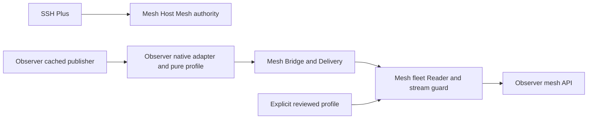

# Networking SDK independence review and implementation plan

> Historical record. This document preserves its original checkpoint and may describe retired providers, interfaces or plans. Use the [current documentation](../../README.md) for supported setup and behavior.

Review date: 2026-10-10. Status: **proposed SDK design, not an accepted new API**.
This pass reviews source, runs disposable boundary experiments and prepares a
plan. It changes no runtime, frozen wire input, packaged schema, artifact pin or
installed service. The [contract freeze](../../contract-freeze.md) remains normative.

## Decision and scope

The current state-delivery wire contract is sufficient for independent work on
the supported profiles. The Python integration boundary still couples fleet
composition and validity to the reference Observer implementation. Close that
gap through explicit interfaces and compatibility wrappers, rather than another
fleet wire format or a general plugin platform.

Mesh owns networking and Host Mesh authority. SSH Plus is the directly supported
client for this work stream. Tmux Observer and Agent Observer participate only at
their networking/profile boundaries. Their collection, provider semantics,
desktop coordination, refresh/actions and consumers remain owner work. Tmux Plus
and Agent Plus are not acceptance dependencies for this proposed Mesh pass.

Independent source development does not mean unreviewed profile changes or
simultaneous changes to shared live services. Source compatibility, profile
acceptance, package selection and coordinated deployment remain distinct gates.

## Findings from current code

Baseline Mesh source: `172647523f3b5901f519612b6e1f6f059f43ac74`.

| Boundary | Actual state | Consequence |
| --- | --- | --- |
| Wire and framing | Frozen Read/Delivery contracts, two profiles, IPC/SSH stdio, explicit proof/receipt and lifecycle rules | Existing consumers can develop against fixed guarantees. No wire redesign is needed. |
| Generic Delivery | `Client` accepts a payload validator; `Bridge` accepts a fixed-source publisher with snapshot/proof/watch hooks | Request/reply and subscriptions already work without importing Observer packages. |
| Fleet Reader | `reader.read_host` obtains `client.codec.__self__`; composition assumes native snapshot/session fields and fixed owner versions | A callable valid for Delivery is insufficient for fleet reads; profile implementation is implicitly part of the SDK. |
| Configured endpoints | Both `configured_read` and `remote.connect_catalog_host` construct `ObserverCodec` directly | Injecting a replacement only at local connection setup leaves SSH coupled. |
| Response validation | `view.validate_response` constructs reference codecs, reconstructs native fields and checks domain identities | Merely removing imports or bypassing validation would weaken the accepted contract. |
| Consumer guard | `ReadGuard` reads native publisher identifiers; `current_sessions` handles domain receipt membership and eligibility | Domain extraction and generic stream validity must be separated together. |
| Reference publisher | `ObserverAdapter` owns native requests, stream guards, source receipts and bridge wrapping | It mixes native-service adaptation with reusable Mesh delivery mechanics. |
| Auxiliary paths | CLI/probe/profile tools select the reference integration; catalog imports its generic digest helper from `observer` | All entry paths and import direction need review, not only Reader's constructor. |
| Authority client | SSH Plus aliases the reviewed `authority` module and preserves model-class identity and patch seams | SDK cleanup must not reorganize this authority ABI or introduce a second store writer. |
| Authority acceptance tooling | `check-authority-compat.py` requires literal equality with SSH's original legacy extraction; current Mesh has the reviewed bounded captured-byte read seam | That historical extraction guard rejects current Mesh. Preserve the negative; define current behavioral/ABI acceptance against the reviewed Mesh baseline instead of silently bypassing the comparison. |

Relevant source: [Reader](../../../src/mesh_plus/reader.py),
[configured reads](../../../src/mesh_plus/configured_read.py),
[SSH connection binding](../../../src/mesh_plus/remote.py),
[validation and guards](../../../src/mesh_plus/view.py),
[reference adapter](../../../src/mesh_plus/observer.py), and
[authority compatibility gate](../../../scripts/check-authority-compat.py).

The existing native integration tests are valuable compatibility tests, but many
fleet tests use the reference Observer adapter. They do not yet prove that an
independently supplied profile works through the entire SDK.

## Alternatives reviewed

| Approach | Benefit | Limitation | Disposition |
| --- | --- | --- | --- |
| Document and pin the existing reference codec | Lowest immediate change; current supported integrations continue | Hidden class/method binding and domain interpretation still coordinate releases | Retain as compatibility path, not the independence endpoint. |
| Make only codec introspection explicit | Small useful first step | Configured SSH, composition, response validation and guards remain coupled | Intermediate implementation phase only. |
| Explicit profile boundary throughout the existing SDK | Separates domain interpretation while preserving reviewed output and networking checks | Requires careful delegation and differential compatibility tests | Recommended. |
| Opaque generic fleet payload wire plus automatic plugins | Allows arbitrary producers | Changes the frozen product/contract, adds discovery and security obligations, loses current native reconstruction guarantees | Outside scope. |

## Proposed responsibility split



The profile exposes facts about its payload; Mesh applies the networking rules.
Mesh does not inspect provider names, infer native activity, or implement
presentation/actions. A profile is trusted installed code, explicitly supplied
by its owner. A remote payload never chooses a Python module, executable, path,
profile implementation or capability set.

### Pure profile boundary

Define a small structural interface and explicit immutable binding, using
Python 3.11-compatible annotations. The following is the proposed v1 surface
for review; it is not exported or implemented by the current package.

```python
class BoundStateCodec(Protocol):
    host: str
    source: str
    profile_id: str

    def validate_bridge(self, payload: JsonObject) -> None: ...
    def inspect_native(self, frame: JsonObject) -> NativeState: ...

class StateProfile(Protocol):
    descriptor: ProfileDescriptor

    def bind(self, host: str, source: str) -> BoundStateCodec: ...
    def validate_response(self, response: JsonObject) -> None: ...
    def restore_native(self, owner: JsonObject,
                       records: Sequence[JsonObject]) -> JsonObject: ...
    def record_host(self, record: JsonObject) -> str: ...
    def record_identity(self, record: JsonObject) -> tuple[str | int, ...]: ...
    def record_receipts(self, record: JsonObject,
                        state: NativeState) -> frozenset[ReceiptKey] | None: ...
    def record_eligible(self, record: JsonObject, state: NativeState) -> bool: ...
```

`ProfileDescriptor` contains SDK interface version, accepted profile ID, native
protocol/version, reviewed contract digest and native frame byte ceiling.
`NativeState` contains lossless owner metadata/service and records, source clock,
publisher incarnation, emitted time and original normalized receipts.
`ReceiptKey` is the opaque `(sourceId, component)` pair. These are local typed
structures over existing validated fields, not additional wire objects. Core
validates JSON types, descriptor bounds and receipt ranges; frozen dataclasses
alone are not deep immutability or native validation.

`validate_response` performs domain/profile validation in addition to compulsory
Mesh checks. `restore_native` must exactly reconstruct the body bound by the
owner digest. Record identities/receipt keys are domain facts; Mesh checks
uniqueness, attribution and expiry without interpreting their values.
`record_receipts` returns a nonempty required set for a potentially current
record, or `None` for insufficient evidence. Empty sets cannot grant positives.
`record_eligible` applies only native eligibility. Core requires ready delivery,
an unrevoked view and all required receipts current/partial and unexpired before
returning a record. The reference implementations must reproduce the existing
effective selector exactly, including its conservative eligibility conditions.

| Profile responsibility | Required facts/operation | Mesh checks that remain compulsory |
| --- | --- | --- |
| Describe compatibility | Accepted profile ID, native contract version/schema identity, bounded native payload size | Only the two reviewed profile IDs are advertised; no support inferred from a package version or extra fields. |
| Bind a source | Bind one host and configured source; produce an explicit bound codec | Host/source/profile must match resolved endpoint and checked hello. Binding is immutable across a connection. |
| Validate native payload | Pure validation and parsing through supported Observer facades | Framing, JSON restrictions, byte/metadata ceilings, request correlation and lifecycle checks remain Mesh-owned. |
| Extract state | Lossless owner metadata/service, ordered unmodified records, publisher incarnation, source clock and emitted time | Profile output must satisfy the frozen schema, preserve roundtrip/digest identity and never invent records. |
| Expose source evidence | Original opaque receipt keys, accepted times, native health and expiry | Mesh binds receipts to native evidence and proof; health cannot improve and expiry cannot be renewed by delivery. |
| Describe records | Pure host/identity extraction and native reconstruction | Mesh enforces scope, host order, duplicates, exact owner reconstruction and original evidence attribution. |
| Qualify current records | Pure domain eligibility using the already checked receipt-validity context | Mesh revokes all positives on disconnect, gap or terminal; eligibility cannot restore expired transport evidence. |

Use explicit binding instead of inspecting a callable's `__self__`. The resolved
endpoint carries its bound codec alongside the owned client factory. The factory
must use that codec's validator and the same host/source/profile for Delivery.
Reader checks the connection binding before requesting data. Generic Delivery
continues to accept a simple validator; it need not become domain-aware.

The lossless state projection is internal SDK data, not a new transmitted DTO.
It preserves the existing `owner`, `sessions`, receipts and proof fields exactly.
Generic proof/expiry checks must not move into an optional domain validator.
Separate raw retained records from an effective/current selection: the former
stays lossless; the latter can be conservatively empty.

Domain eligibility stays behind the profile interface. No attempt is made here
to specify Agent or Tmux eligibility anew. Existing behavior is the differential
oracle until its owner reviews a semantic change. A shape-only check cannot
certify that a profile's native interpretation is correct.

### Publisher boundary

Keep the existing fixed `host`, `source`, `profile`, `capabilities`,
`validate(payload)`, async `snapshot(parameters)`, async `proof(parameters)` and
async `watch()` yielding `Publication(payload, epoch, barrier)` service surface.
Document precise iterator, cancellation and ownership rules instead of inventing
a new publisher API solely for the refactor.

The Observer owns its native cached service request/stream validation and pure
interpretation. Mesh can retain reusable bridge wrapping and original-receipt
proof mechanics. A nonce proof must acquire a checked cached native reply after
the nonce arrives; copying a retained watch publication is not sufficient.
Observation never starts collection or increases its cadence. Native restart,
gap and malformed input revoke delivery validity; no silent polling fallback.

Do not move the entire adapter into either Observer in the initial Mesh phase.
First introduce the pure injection boundary and preserve the reference adapter.
Native I/O extraction and owner-package adoption become separately bounded tasks
after the SDK conformance gate works without sibling source checkouts.

### SDK entry points and compatibility

Recommended additive shape:

```python
# Proposed SDK extension; this keyword is not implemented today.
reader = await configured_reader(
    "agent", source="agent", socket=owned_socket,
    scope="fleet", authority=selected_authority,
    profile=reviewed_profile,
)
```

Thread the same explicit profile through configured IPC and SSH binding, Reader,
response validation, reconstruction and ReadGuard. Independent code must never
have to patch a Mesh global registry to select its profile.

Preserve existing domain-string entry points, constructors, CLI arguments and
reference `ObserverCodec`/`ObserverAdapter` names as compatibility wrappers.
Default calls continue selecting the reviewed built-in profile, with lazy
Observer dependencies. Direct `Endpoint` construction remains supported through
a documented compatibility wrapper; arbitrary validator callbacks do not
silently acquire fleet semantics. Reject missing or incompatible profile
bindings with bounded SDK/contract errors before native dispatch when possible.

Publish `mesh_plus.api` as a documented public SDK facade with an interface
version, separately from wire protocol 1,
domain profile version 1 and native Observer versions. The new surface should
have signature/behavior fixtures and an explicit compatibility policy; changing
private implementation or producer checkout HEAD does not change that surface.
Do not certify this proposed surface as frozen before its conformance gate passes.

Python structural protocols describe interfaces, not behavioral acceptance.
Runtime method-presence checks are insufficient to verify signatures or receipt
semantics. Keep runtime admission validation and executable conformance tests.
See the [Python 3.11 typing documentation](https://docs.python.org/3.11/library/typing.html#typing.Protocol)
and [protocol specification](https://typing.python.org/en/latest/spec/protocol.html).

### SSH Plus boundary

Keep the reviewed `authority.py` extraction, Host Mesh v1 wire/model classes,
configuration ownership, route-health writer and CLI operations unchanged.
SSH Plus remains responsible for picker/history, terminal launch and ad-hoc SSH.
Mesh's networking service continues consuming configured routes and policies.
Shared ownership is not a reason to merge picker state with catalog health.

The default configured authority and explicit route-report opt-in stay as they
are. No new fallback, authority migration, store format, history write or
unversioned SDK deployment is part of this design. Generic digest/clock helpers
may be extracted with byte/behavior parity, without modifying authority bytes.

## Independent development and release policy

| Change | Coordination needed |
| --- | --- |
| Mesh transport, cancellation, diagnostics or internal performance under the same guarantees | Mesh source gates and released SDK conformance; no Observer checkout edits. |
| Observer collection or domain behavior that preserves the accepted native/profile boundary | Observer owner gates; Mesh need not study provider/UI details. |
| Observer implements its profile against the released SDK | Its conformance fixture and pinned Mesh package; the other Observer need not advance. |
| Native wire/profile fields, interpretation, validity or capability guarantees change | Explicit profile/contract review. Neither updating a source hash nor passing schema validation alone approves it. |
| Public Mesh SDK breaks | Versioned SDK review and migration path; retaining wire compatibility does not make an SDK break harmless. |
| Shared installed Mesh/bridge controls or rollback change | Coordinated deployment validation of affected networking endpoints; source development remains parallel. |

Use stable versioned fixtures and schema/behavior checks for producer
compatibility. Retain `--check-sources` as historical provenance verification,
not the default independent-development gate. The source commits in LOCK remain
frozen references; do not regenerate them to follow live checkout heads.

Keep normal CI independent of sibling checkout locations. A scheduled/manual
integration matrix may select exact released Mesh/Observer wheels; it provides
integration evidence without making every source PR wait for every other HEAD.

## Validation performed in this design pass

[Review evidence](../../evidence/2026-10-10-sdk-boundary-review/README.md) retains exact
probe sources, report hashes and exclusions.

- An actual private IPC Bridge/Client experiment, with Observer imports blocked,
  passes request/proof/subscription and owned cleanup using a plain callable
  validator. Its synthetic body does not pass or advertise native profile
  acceptance; this isolates the generic Delivery seam.
- The same callable is rejected by current Reader before request dispatch due
  to missing `__self__`. Current configured-reader profile injection is also
  unavailable. These are expected negative boundary probes, not transport bugs.
- A design-only lossless projection model roundtrips validated Tmux and Agent
  local/remote fixture states, preserving owner fields, records and original
  receipts. Four cases pass; four current/expired effective-selection comparisons
  also match the existing selector. This demonstrates feasibility, not future SDK
  conformance or acceptance of an unimplemented injected Reader/ReadGuard.
- Frozen lock/schema checks, the canonical core gate and current SSH source
  regressions with Mesh selected are run separately and reported in the evidence.
  The older literal-extraction compatibility gate rejects before tests; current
  behavior tests are separate evidence, not a converted pass for that guard.

## Implementation sequence and acceptance

| Phase | Work | Exit gate |
| --- | --- | --- |
| 0: accept SDK specification | Review the proposed exact profile/binding/projection signatures, public facade, ownership/error/cancellation rules, examples and compatibility policy; review the historical authority gate's applicability | Every current Reader/view/remote hook is accounted for; SSH authority unchanged; current ABI/behavior gate distinguished from legacy extraction provenance; no normative change required. |
| 1: explicit binding | Introduce bound profile/codec and remove Reader's implementation-specific introspection; retain default wrappers | Callable-object profile works without inheritance or `__self__`; mismatched host/source/profile rejected; existing integrations still pass. |
| 2: complete injection | Thread profile through IPC/SSH/configured reads, Reader, reconstruction, validation and guards; extract pure reference profile responsibilities | Both accepted profiles produce identical fixed-clock views, errors, receipts/proofs and effective results; CLI defaults remain compatible. |
| 3: independent conformance | Mesh-owned synthetic profile/publisher fixtures and reusable SDK boundary suite, plus public SSH compatibility | Generic fleet poll/watch/resync/expiry/cancellation tests run with Observer imports blocked; reviewed native profile tests run against wheels, not sibling HEADs. |
| 4: package handoff | Isolated fresh wheel and SDK examples; publish only after review and provide Observer networking integration tasks | Standalone core remains usable without Observers; old entry points work; exact artifact/schema parity and public authority tests pass. |
| 5: optional owner adoption | Each Observer adopts its pure profile/native adapter independently against the released SDK | Its own networking conformance and package gates; no Plus migration or provider-policy work is required by Mesh. |

The first Mesh implementation can complete phases 0-4 with built-in compatibility
profiles and test-only external fixtures. It must not claim both Observers have
moved their code. Phase 5 is owner adoption, not a prerequisite for continuing
Mesh development against the public boundary.

Mandatory adversarial cases: wrong host/source/profile; spoofed nonce or owner
digest; missing/changed receipts; lease/health upgrades; clock mismatch; mutated
native rows/reconstruction; duplicate/out-of-scope records; warming/partial/stale
source evidence; EOF/gap/reconnect and publisher restart; catalog change; slow
consumer, setup deadline, cancellation and independent healthy-host preservation.
Retain proof cadence defaults, resource ceilings, setup concurrency and original
error behavior until separately reviewed. Measure validator/projection cost to
avoid reintroducing redundant copies or bypassing semantic validation for speed.

## Risks, limits and ready-to-start condition

The principal risk is moving checks out of Mesh while preserving only shapes.
Keep generic networking checks mandatory and make domain behavior differential
against reviewed profiles. Trusted injected Python is not a security sandbox.
No global mutable plugin discovery, negotiated dynamic schema download, generic
arbitrary remote executable, new backend or event product is required.

The current wire supports two native profiles; this proposal does not promise
arbitrary new domains can join without review. Mesh/source and Observer packages
may advance independently only while their accepted compatibility boundary holds.

Implementation is ready to start when phase 0's signature specification and
conformance matrix are reviewed. No additional transport research, Plus work,
provider investigation or live paired rollout is needed to begin that bounded
SDK implementation. Deployment is a later explicit gate if installed artifacts
are selected, rather than part of a source-only SDK refactor.
