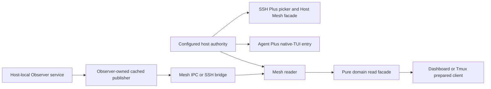

# Mesh Plus architecture

Mesh supplies two related interfaces: a single configured host/route authority
and reusable cached-state delivery. Domain meaning belongs to the producer;
desktop policy and actions belong to consumers.

## Authority

Mesh owns logical identity, aliases, route order, revisions and route-health
reports. SSH Plus owns its canonical Host Mesh v1 process contract, picker,
successful-connection history and terminal entry. Both facades refer to one
selected authority, not competing registries. Peer scope is endpoint-specific
and directional. No reciprocal route is inferred from an incoming connection.

## Cached delivery

The reader binds an immutable catalog revision, ordered host selection, source
and pure profile. A host-local bridge exports only its configured owner source.
IPC and persistent SSH carry cached poll/proof/replacement watches; optional
WSS has its own accepted addendum and explicit selection.

The producer profile validates native payloads and supplies exact identity,
source attribution, receipt requirements and lossless reconstruction. Mesh
independently enforces envelopes, limits, scope, clock/proof bindings and
delivery validity. A custom profile cannot waive those checks.

One host/source failing does not erase healthy siblings. Missing, warming,
partial and expired outcomes remain explicit. Successful delivery does not
upgrade partial producer coverage. Heartbeats and retained rows renew no native
fact; gaps, disconnects and incarnation changes revoke positive authority.

## Ownership and lifecycle

Mesh owns its channels, cancellation, bounded framing/queues and cleanup.
Consumers retain presentation and reconnect policy. Producer-native collection,
refresh scheduling, conversation control, terminal launch and action retry are
outside cached state delivery. Tmux's independent refresh/actions are not new
Mesh capabilities. Agent Plus uses host routing without consuming state reads.

The [frozen boundary](../contract-freeze.md) and [lock](../../contracts/LOCK.json)
take precedence over design sketches and reserved schemas. SDK 1, native profile
versions, preparation/admission interfaces and package versions are independent.
Use [handoff](../guides/integration.md) for profile selection and acceptance gates.

## Optional and retired paths

Prepared/admitted reads are explicit local optimization interfaces with the
same expiry and revocation obligations. The complete-view change feed is a
separate opt-in transport feature; WSS is also separately selected. Neither
restores the dark delta-sync experiment or grants native-event replay.

Standalone Agent active-only profile support is withdrawn. Working-set and full
Agent profiles remain independent. Frozen historical schema bytes are retained
without advertising support for a retired profile.

Implementation lives under `src/mesh_plus/`: authority owns the catalog,
delivery/transport own channels, the Reader composes owner outcomes, and pure
profiles own native reconstruction. A bridge exports one host-local source,
not an aggregated fleet or an arbitrary executable selected by a remote request.
