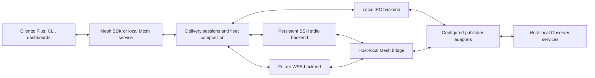

# Mesh Plus transport and subscription design

Status: second design candidate, 2026-10-09. This extends the read design; it
does not implement a selected runtime or allocate new Observer wire versions.

## Ownership and layers

Mesh Plus owns both ways of delivering a domain API: clients request through
Mesh, or subscribe through Mesh and receive publisher updates. A subscriber
opening a connection does not turn pushed publications into polling. Connection
initiation is a routing decision independent of publication semantics.

| Layer | Owns | Does not own |
| --- | --- | --- |
| Domain API/profile | Operation meaning, records, coverage, original leases, event cursors | SSH/TLS, fleet recovery, UI decisions |
| Mesh delivery session | Request correlation, subscription lifecycle, framing guards, limits, cancellation, stream outcomes | Native classification or collection |
| Transport backend | Authenticated peer binding, channel setup, byte/message carriage, bounded close | Event replay, source freshness, domain actions |
| Fleet coordinator | Immutable host selection, independent outcomes, per-host recovery, projection | Fleet-global event chronology |
| Optional local Mesh service | Shared upstream lifetime, admission, independent downstream delivery | Durable event journal, notifications, desktop context |

The SDK exposes `request(selection, source, operation, parameters)` and
`subscribe(selection, source, product, start)`, with `cancel(handle)` and typed
delivery outcomes. These are conceptual API signatures, not installed names.
Operations come from the configured descriptor's allowlist. This initial
candidate carries cached reads, state subscriptions and supported event reads;
it does not expose arbitrary RPC methods, paths, executables or writes.

The [delivery candidate](../contracts/mesh-delivery-v1/contract.md) supplies
strict outer-frame schemas and executable lifecycle scenarios. The existing
[Mesh Read 1](../contracts/mesh-read-v1/contract.md) remains the domain-facing
state projection. The new delivery protocol lives beneath it, not alongside it
as a competing session schema. Its initial SSH implementation may translate to
the existing fixed-source read bridge; later it can replace that wire explicitly.

This candidate wire is for host-local owner channels. The SDK performs fleet
selection and composition above it. A shared local service's state-facing IPC
must accept the existing Mesh Read request/selection and return that same
projection; it cannot send a fleet selection to a fixed-source owner bridge.
Freeze that wrapper's endpoint/framing at its implementation gate. Event-facing
fleet selection similarly preserves independent native cursors and awaits the
producer event codec, rather than borrowing state selection as replay proof.

## Publisher integration and local equivalence

Observers retain host-local collection and publication. Their adapter declares
source identity, supported operations/products, native codecs, source clock and
lease extraction, and optional replay/cursor handling. Mesh owns the adapter's
delivery hosting and networking. No client subscription invokes provider
discovery, accelerates collection or installs hooks. Existing explicit Tmux
refresh hints remain separately negotiated; Agent gains no refresh capability.

Local and remote requests use the same client API and domain result. Same-user
local IPC may invoke an adapter directly or use a local Mesh endpoint. Remote
SSH calls a fixed Mesh bridge and communicates over its input/output. A future
WSS endpoint hosts the same delivery session. Backend capability differences
are visible at negotiation; a missing event feed is `unsupported`, never empty.

Do not require both producers to replace their local services simultaneously.
Tmux Service 1 and Agent Service 2 can remain behind their independent adapters.
Host-local publisher processes own native retention and sampling. Mesh does not
make the Observer collector a network server.

## Request and subscription lifecycle

1. Authenticate the route, open a bounded channel and negotiate an exact source,
   host, product, profile and limits. A hello nonce binds the reply to this attempt.
2. For a request, allocate a channel-scoped ID, register its local deadline and
   dispatch an allowlisted cached operation. Accept one matching terminal result.
3. For a subscription, allocate an ID and establish its baseline or replay
   barrier before data. Server acceptance must echo the requested start mode.
4. Publisher messages carry an independent stream sequence. State revision or
   event admission cursor is a separate domain identifier, not that sequence.
5. Cancel one handle without closing siblings. An `ended` barrier means no more
   messages for that handle. Timeouts do not prove the remote operation stopped.
6. Disconnect closes the delivery epoch. Pending replies cannot complete a new
   request, and old channel frames cannot enter a new subscription.

Request IDs and subscription IDs are never reused in a channel. Bound ID
tombstones and channel lifetime: after 4096 total handles, drain and rotate the
channel. Reopening safe read operations is a new attempt; this cannot become an
automatic write retry policy.

Native state watch does not need to produce material changes continuously.
Mesh runs local expiry timers and reports affected source validity changes even
when the channel has no new publication. A transport heartbeat establishes
channel liveness only. An event heartbeat/checkpoint can establish admission
progress; neither renews source evidence or resets event age.

## Two subscription products

| State | Ordered events |
| --- | --- |
| Initial complete view establishes a baseline | Start explicitly live, retained, or after a producer cursor |
| Replacement views may be coalesced within bounds | Published records retain exact identity and admission order |
| A skipped queued view requires gap and full resync | A dropped record requires delivery/retention gap evidence |
| Reconnect obtains a new baseline and freshness proof | Reconnect resumes from the last downstream-accepted native cursor if retained |
| Local timers expire current claims | Event receipt clocks never become current state leases |
| Row omission is not an inferred lifecycle event | A state snapshot cannot reconstruct missed occurrences |

Client-side filters must advance an event checkpoint over records inspected but
hidden. A fleet cursor maps host/source/publisher epoch to native progress.
There is no global event cursor or timestamp order implying cross-host causality.
Delivery acceptance is not a user's notification/action acknowledgment.

Agent's proposed E0 event schema, endpoint and retention contract are still a
producer gate. Mesh specifies its delivery envelope now but advertises no event
capability until the adapter validates a concrete accepted producer contract.
Tmux supports state push now; an ordered Tmux event product likewise needs its
own domain contract and cannot be invented by diffing views.

## Flow control and failure isolation

Transport backpressure is insufficient to isolate a slow client. Each
subscription has byte and frame credit, bounded unsent queues and independent
progress. Credit updates advertise cumulative permitted totals, so repeated
credit cannot multiply admission. They do not acknowledge application effects.

Initial candidate bounds are eight outstanding requests and eight subscriptions
per logical channel; 32 downstream consumers per Mesh reader; two state frames
(one started, one pending) or 64 pending event records/1 MiB per subscriber;
64 KiB control reserve per channel; and a 96 MiB total reader-owned byte budget.
Native queues, transport/library buffers and decoded representations need their
own accounting before runtime acceptance; these are not an RSS guarantee.

Negotiated message capacity must accommodate the domain maximum plus wrapping.
State channels allow up to 8 MiB + 80 KiB: Agent's owner frame can already use
8 MiB + 16 KiB, and Mesh reserves a further 64 KiB for wrapping. Event data
uses the producer's declared record limit, initially proposed at 16 KiB for
Agent, plus wrapping. A subscriber without credit for a complete frame waits
within a bounded deadline or fails explicitly; there is no partial domain frame.

When the state queue replaces an unsent view, emit an ordered gap then full
resync. When an event queue fills, stop that reader with an explicit gap/cursor,
or close its channel if the control reserve cannot drain. Do not block native
collection or continue silently with a later cursor. A slow downstream cannot
advance the shared upstream cursor on its behalf.

Initial physical channels are isolated by host/source/product. State traffic
does not share an application FIFO with small event records. Multiple logical
subscriptions may share that upstream only when their replay interests permit
it. Sharing an SSH TCP connection still shares a loss/congestion domain; it is
not equivalent to independent event latency. Cross-product multiplexing is a
measured later option, not an assumption about fairness.

## Freshness without a second inventory copy

The baseline read bridge remains valid: a pushed state candidate is checked,
then a correlated cached proof gives conservative remaining source validity.
The full inventory appears in both messages. This duplicates bytes, and short
leases can repeatedly move large Agent inventories even when records are stable.

Add an optional negotiated `digest-proof` extension. The client asks for proof
of the exact retained full owner-frame digest. After receiving the nonce, the
bridge performs and validates a fresh cached local read, verifies the same
owner incarnation, clock, view and complete original component receipts, and
checks that the requested frame remains the same semantic source version.
Only explicitly adapter-declared local delivery fields such as frame sequence
and encoding time may differ. Snapshot contents, leases, coverage, errors,
source counters and source identity are never excluded from that comparison.

If it matches, return only the requested full-frame digest, source binding,
original clock, original receipt counters and remaining validity calculated
after the cached read. The client must already have validated that exact frame.
If it changed, return a full replacement proof instead. If the publisher was
lost or changed incarnation, return failure; the bridge's retained copy cannot
prove continued authority. This is digest binding over an authenticated channel,
not an independently signed publisher attestation.

The conservative expiry calculation remains
`received + max(0, remaining - whole_request_RTT - margin)`. No cross-host
absolute-clock subtraction or new clock drift assumption is needed. Proofs are
per upstream source, coalesced across subscribers; they do not collect native
state. This saves repeated payload bytes, not a proof round trip or provider
collection cost. Renewed native receipts changing the source version require
full replacement unless a separately reviewed delta protocol is added.

Unsolicited candidate arrival, SSH keepalive, WebSocket Pong and event checkpoint
cannot renew state facts. A cached proof must not report a new lease duration
from receipt arrival. Full-proof fallback is mandatory when the extension is
unsupported; compact proof is independently gated before becoming a default.

## Embedded and shared local-service topologies

Both modes implement the same API and semantics:

| Mode | Fit | Cost |
| --- | --- | --- |
| Embedded Mesh runtime | One CLI or an existing long-lived Tmux coordinator | Each process owns its own upstream channels |
| Local per-user Mesh service | Several independent Plus/dashboard/alert clients | Adds one process, endpoint, lifetime policy and downstream queues |

A local service is a supported implementation target now, not a compulsory
central broker. First extract and prove the embedded engine. Add the service
wrapper before migrating multiple independent consumers if measured sharing
benefits justify it. Do not put a second always-on Mesh service underneath an
existing coordinator without accounting for duplicate connections.

Shared state subscription keys include authenticated authority/user, catalog
revision and route binding, host, source, product, profile and upstream selector.
UI/desktop context and local presentation filters are downstream concerns.
Event subscriptions additionally carry start/cursor interest. Two clients with
different after-cursors cannot simply join the same live feed. Initially give
them distinct replay channels, or establish independent replay barriers before
joining a shared live tail. If no validated replay primitive exists, refuse
sharing rather than silently skipping a requested suffix.

A broker may retain bounded transient event queues for active clients; it adds
no durable journal. On local-service restart, clients re-establish state or
resume events from their own last accepted native cursor. Loss beyond producer
retention is explicit. Reference-counted upstream interest closes idle channels;
an explicit bounded prewarm policy may be added without starting collectors.

## Transport selection and route authority

Downstream freshness has its own handoff rule. A local-service client must
validate the Mesh reader's boot/time namespace and use the original translated
deadlines when it shares that clock domain. A different namespace/device needs
a separately proved remaining-validity handoff or explicit unsupported outcome;
the service cannot restart a TTL when forwarding its cache. A service restart
also establishes a new delivery guard and state baseline, not recovered events.

Start with IPC locally and persistent non-PTY SSH stdio remotely. No port
forwarding is required for SSH stdio. Keep SSH configuration/host keys, jump
hosts and background route reporting under the existing Host Mesh authority.

WSS is the preferred direct-network alternative, evaluated in
[backend comparison](transport-evaluation.md). It requires an explicitly
configured Mesh listener and authenticated principal-to-host/source binding.
TLS server identity alone is not user authorization. Local IPC peer credentials,
SSH remote-user identity and WSS client credentials are distinct auth modes.
Never fall back from rejected authentication to a different backend automatically.

The Host Mesh v1 catalog is SSH-specific. Do not add WSS fields to that published
schema in place or report WSS outcomes as SSH route health. Initially retain v1
as the SSH projection and define a separately versioned Mesh endpoint registry
for source capabilities, backend reference and authenticated scope. Once an
alternative is implemented, explicitly reconcile it under one Mesh authority.
SSH Plus continues selecting SSH routes and tracking explicit user connections.

The initial endpoint registry references existing canonical host IDs; it is not
a second alias/host identity writer. WSS-only hosts require a unified versioned
Mesh catalog capable of non-SSH endpoints, with Host Mesh v1 retained as the
SSH-compatible projection. Do not fabricate an SSH route to admit such a host.

Publisher-initiated relay connections and external brokers are future topology
choices. The present subscription requirement needs a long-lived channel from
reader to publisher, followed by publisher-to-reader messages. It does not
require reverse callbacks, distributed replication or a fleet-global listener.
